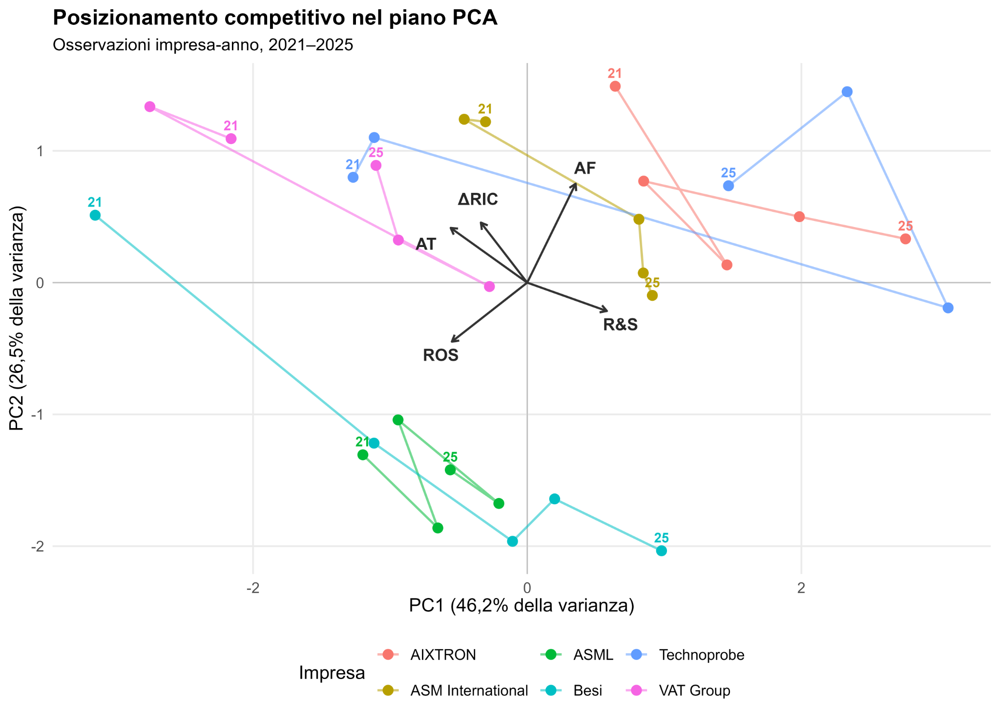

# European Semiconductor Financial Benchmarking (2021–2025)

[Project overview — English (PDF)](docs/project-page.pdf) · [Original report — Italian](report/report.pdf)

**Financial benchmarking · Principal component analysis · R · Semiconductor supply chain**

Financial comparison of **ASML, ASM International, Besi, AIXTRON, VAT Group and Technoprobe**, built from published corporate financial statements. The study compares growth, operating profitability, R&D intensity, asset utilization and capital structure, then explores financial profiles through standardized PCA.

> **Status: private, computational validation passed.** The original input and historical workbooks were audited independently, and the reconstructed workflow passed both source-integrity and full R regression tests in a clean GitHub Actions environment ([successful run](https://github.com/Salvatore-Megna/european-semiconductor-benchmarking/actions/runs/41731168922)). The advanced archived report still requires a final editorial/source-rights review before public release.

## At a glance

| Scope | Detail |
|---|---|
| Panel | 6 companies × 5 years (2021–2025) = **30 company–years** |
| Supporting year | 2020 (lagged ratios and normalized reference charts only) |
| Raw inputs | 36 company–year rows, 6 financial ratios, documented annual statements |
| Analysis | Annual median benchmarks, IQR outliers, 5-variable standardized PCA |
| Software | R, `readxl`, `dplyr`, `tidyr`, `ggplot2`, `writexl`; LaTeX report |

## Key results

- Median **revenue growth** across the six firms was **31.70% (2021)**, **−5.33% (2023)** and **11.07% (2025)**.
- PC1 accounts for approximately **46.17%** and PC2 for **26.47%** of standardized indicator variance (**72.65%** combined).
- The 1.5×IQR screen flags **Besi 2021 (revenue growth)** and **VAT Group 2022 (asset turnover)**. Both remain in the analysis.



*Original recovered company–year PCA plot. Positions are descriptive, not evidence of causal effects from AI investment.*

## Methodology

The source workbook preserves the underlying financial data, official filing links, quality notes and Excel formulas. The six ratios are revenue growth, ROS (EBIT/revenue), R&D intensity, asset turnover (revenue/mean of current and prior assets), equity autonomy and current ratio.

Each year the benchmark is the **common median of the six companies**, not a leave-one-out median. All six ratios support benchmarking. PCA uses **five standardized ratios**, excluding current ratio. The 2020 values only support first-year lag calculations, the 2020=100 revenue series and the reference R&D figure. No IQR-flagged observations are removed.

## Reproduce

Start in the repository root with **R 4.4+**:

```bash
Rscript -e 'install.packages(c("readxl","dplyr","tidyr","ggplot2","writexl"), repos="https://cloud.r-project.org")'
Rscript scripts/run_all.R
Rscript tests/check_results.R
```

Generated plots (both **PDF and PNG**) and the 15-sheet workbook are written under `outputs/`, excluded from Git. The regression test compares **180 indicator values**, annual median benchmarks, PCA eigenvalues and association magnitudes with the recovered historical results, and checks the two known outliers.

Source-integrity checks can be run with:

```bash
python -m unittest discover -s tests -p 'test_*.py' -v
```

Both jobs in the [GitHub Actions workflow](https://github.com/Salvatore-Megna/european-semiconductor-benchmarking/actions/runs/41731168922) **completed successfully**: authentic-source checks and end-to-end R reproduction. The R job confirmed the source workbooks, 180 ratio values, annual medians, PCA eigenvalues/association magnitudes, two expected IQR outliers, and regenerated figures.

## Repository layout

```text
data/raw/               Corrected source workbook with formulas and citations
scripts/run_all.R       Single canonical, portable R pipeline
tests/                  Artifact integrity and analytical regression tests
results/                Archived 15-sheet numerical reference workbook
report/                 Compiled PDF, LaTeX source and five figures
docs/                   Provenance and original unmodified R/TeX archives
.github/workflows/      Automated validation
outputs/                Regenerated results (gitignored)
```

See [data documentation](data/README.md), [archived report](report/report.pdf) and [source provenance](docs/PROVENANCE.md).

## Limitations and publication status

This is a small descriptive panel across different parts of the European semiconductor supply chain, not a representative survey or causal study. Comparisons use ratios and indexed revenue rather than absolute mixed-currency totals (EUR/CHF). Financial restatements and reporting differences remain relevant, and the PCA axes carry no causal interpretation.

Recovered report is in Italian; repository documentation is in English. **Keep private** pending a final review of the report revision, company-source redistribution terms and licensing. Computational validation has already passed. The historical R v7 is preserved but the executable script is an explicit adaptation; no unrecovered lockfile or license is claimed.
